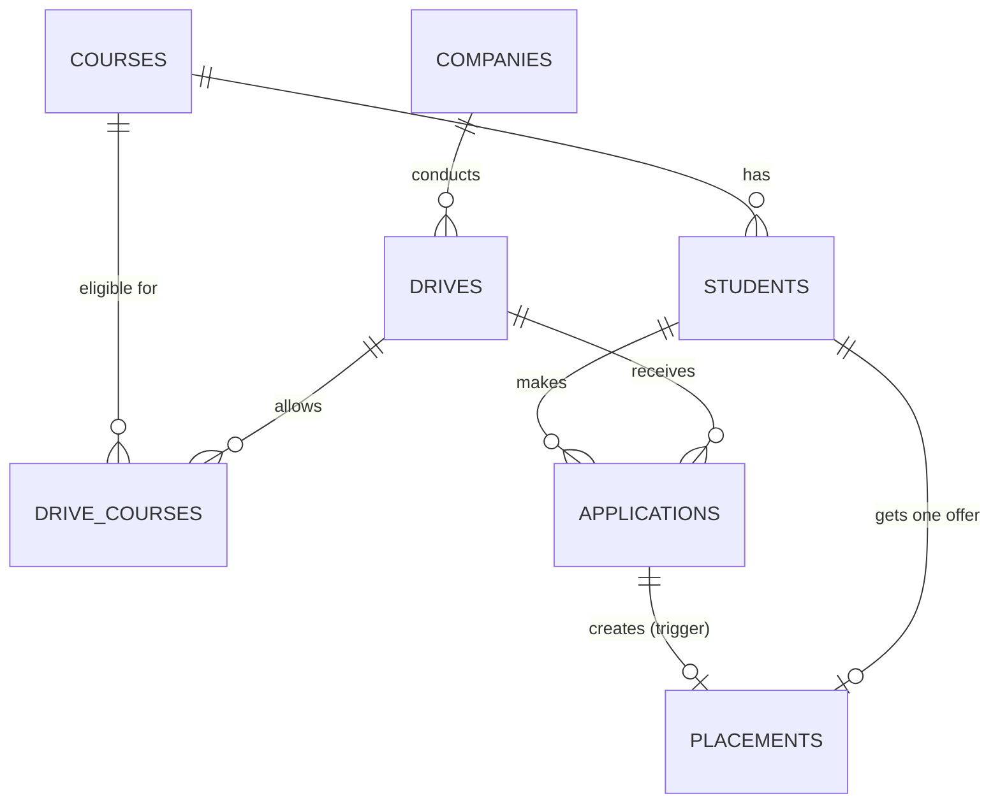

# Placement Management System

A database-driven web application that manages campus placement drives: students, companies, drives,
applications and results. The business rules (eligibility checks, placement status updates, reports) live
**inside MySQL** as stored procedures, a stored function, triggers and views. A small Flask app sits on top of them.

> All student data in this project is randomly generated demo data. No real students are used.

## Features

- **Normalized MySQL schema (3NF)** with primary/foreign keys, `CHECK` constraints, unique keys and indexes
- **Stored function** `fn_eligibility_reason()` - returns `ELIGIBLE` or the exact reason a student cannot apply
  (course, 10th %, 12th %, graduation %, active backlogs, deadline, already placed, already registered)
- **Stored procedures**
  - `sp_register_for_drive` - registers a student only if every eligibility rule passes
  - `sp_update_application_result` - changes an application result inside a transaction
  - `sp_drive_summary` - drive-wise counts and selection ratio
- **Triggers**
  - `trg_applications_after_update` - when a student becomes *Selected* it creates the placement, marks the
    student *Placed* and writes an audit log; withdrawing the selection reverses everything
  - `trg_applications_after_insert` - logs every registration
- **Views and joins** for reports: drive applicants, company-wise selected students, drive-wise summary,
  course-wise placement %, top recruiters
- **Flask web app** with full CRUD for students, plus companies, drives, registration, result updates and reports

## Database design



## Tech stack

MySQL 8.0+, Python 3.10+, Flask, mysql-connector-python, HTML/CSS (Jinja2 templates)

## How to run

1. **Install MySQL 8.0+** and make sure it is running. Install Python 3.10+.
2. **Install the Python packages**
   ```bash
   pip install -r requirements.txt
   ```
3. **Add your MySQL details**: copy `.env.example` to `.env` and edit it (user, password).
4. **Create the database** (tables, function, procedures, triggers, views)
   ```bash
   python setup_db.py
   ```
5. **Load demo data** (random students, companies and drives)
   ```bash
   python seed_data.py
   ```
6. **Start the app**
   ```bash
   python app.py
   ```
   Open <http://127.0.0.1:5000> in your browser.

Prefer the MySQL command line? You can also run the SQL yourself:
```bash
mysql -u root -p -e "CREATE DATABASE placement_db"
mysql -u root -p placement_db < sql/01_schema.sql
mysql -u root -p placement_db < sql/02_procedures.sql
mysql -u root -p placement_db < sql/03_triggers.sql
mysql -u root -p placement_db < sql/04_views.sql
```

## Try it

- Open a student -> the page lists every open drive with *Eligible* or the reason they are not eligible.
- Register an eligible student, then open the drive and change their result to **Selected**.
  The trigger creates the placement and the student becomes **Placed** (check *Placements* page and the activity log).
- Change the result back to **Rejected** and the placement disappears again.

Run the end-to-end test (needs the seeded database):
```bash
python -m tests.smoke_test
```

## Useful SQL

```sql
-- Why can't student 5 apply to drive 12?
SELECT fn_eligibility_reason(5, 12);

-- Register through the procedure
CALL sp_register_for_drive(5, 12, @msg);
SELECT @msg;

-- Company-wise selected students
SELECT * FROM v_company_selected ORDER BY company_name;

-- Course-wise placement percentage
SELECT * FROM v_course_placement ORDER BY placement_percent DESC;
```

## Project structure

```
placement-management-system/
|-- app.py              Flask application (routes)
|-- config.py           reads database settings from .env
|-- setup_db.py         creates database + runs the SQL files
|-- seed_data.py        generates random demo data using the stored procedures
|-- sql/
|   |-- 01_schema.sql       tables, constraints, indexes
|   |-- 02_procedures.sql   function + stored procedures
|   |-- 03_triggers.sql     triggers
|   `-- 04_views.sql        reporting views
|-- templates/ static/  HTML pages and CSS
`-- tests/smoke_test.py end-to-end check
```

## Ideas to extend

- Login with roles (admin / coordinator / student)
- Export reports to Excel or PDF
- Email notification when a result is updated
